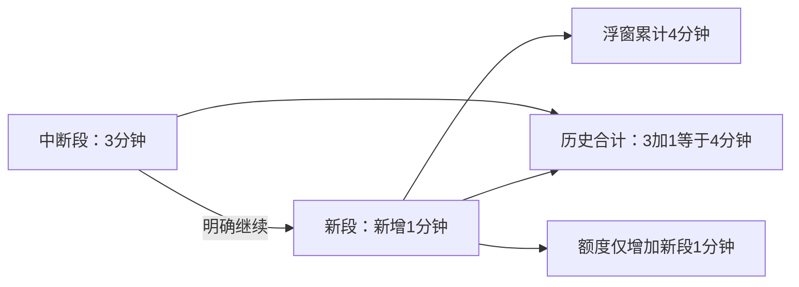

# 正计时方式与异常续计

设置 → 正计时方式，仅保存偏好，不启动计时、不请求悬浮权限。用户仍从首页开始按钮、快捷App、预设、桌面组件或磁贴明确开始。

- **息屏仍计时**（首次默认）：亮屏、息屏持续累计，可通过已有入口手动暂停/继续、结束。
- **随亮屏计时**：正常亮屏累计，息屏/AOD暂停，再亮屏继续同一会话；锁屏亮起也计入。只由屏幕控制暂停，手动入口查看/结束。

当前配置用于普通开始、快捷App及磁贴/组件默认启动；预设保存自己的 `stopwatchBehavior`，首页、桌面快捷方式和组件预设按ID读取同一快照。旧预设缺字段默认为息屏仍计时。编辑草稿取消不写回，保存当前一起采样。开始时确定行为，运行中改设置仅影响下一次，不改全局C4；正计时不创建C4运行时。

绑定App的会话仅在运行时扣该App额度；无绑定不扣任何App。不判断App前台状态，不申请使用情况、无障碍或查询所有应用权限。

## 划除任务与系统边界

| 操作 | FF行为 |
|---|---|
| 最近任务划掉FF | 保存检查点，继续同一前台服务、通知、计时及浮窗 |
| 厂商一键清理 | 若仅移除任务则继续；若厂商同时结束进程，无法保证存活 |
| 回收、崩溃、重启 | 不自动拉活，只保留已保存进度 |
| 系统“停止应用”或强行停止 | 真正停止；再次进FF也不自动继续 |
| 浮窗、通知或应用内明确结束 | 正常结算，不作为待恢复任务 |

沿用 specialUse 前台服务和可见通知，不新增服务、唤醒锁、电池豁免、开机广播、轮询或自动重启。系统不能保证发出最后一次回调，不能承诺精确捕获强杀瞬间。厂商后台设置由用户自行决定，本轮不调整手机设置。

## 异常正计时如何续计

主页空闲时显示最近一条可继续记录；时长记录页的“全部中断正计时”可访问所有日期的候选，不受今日/本周/本月图表限制。入口显示已保存累计、计时方式和最后保存时间。已有会话或启动请求不被覆盖；缺悬浮权限时先授权，返回后明确点击继续。

续计只恢复计数，不主动打开第三方App，不重新执行预设；保留原App归属与当时计时方式。原中断记录不改写，新段通过 `continuationOf` / `rootId` 关联，`carriedMillis` 只用于浮窗累计显示。

后继文件原子保存后，父段不再提供续计；快速重复点击不能创建多个后继。失败启动在服务真正就绪前不写后继或额度。系统停机期间不补算；存储错误不当零值，重试也不把当前进程的活跃记录结算为异常。

旧亮屏记录已有可靠区间，可以续计；旧普通正计时只有可能含暂停的跨度，无法可靠还原运行累计，仅查看/导出。正常结束及旧版“划掉FF结束”的记录不转为异常候选。

## 记录与统计

新正计时都保存实际运行区间、会话跨度和行为，手动暂停及息屏自动暂停均不计有效累计。旧记录保持原口径，不重算。历史图表按每段自己的区间拆分日期，不把承接累计或停机空档重复加入。

新格式有独立 `source=STOPWATCH` 标记，必须同时具有严格检查点；缺失、空值、重叠区间及错误位置对象显示读取错误，不降级成旧格式。原CSV前13列保留，尾部追加续计来源ID、根ID、承接累计秒数与运行活动区间；承接值不参与累计列求和。

续计位置上下文保留原预设ID：存在时读写该ID双向位置；删除后使用检查点内的位置副本，仅写本续计段，不写普通位置或其他预设，不复活已删除预设。

## 方向位置

普通/快捷App共享普通位置表，预设按稳定ID各有一张表；横屏和竖屏分别保存。旧单位置在首次启动方向一次承接，另一方向使用安全默认；已存在方向值不被旧数据覆盖。没有拖动记录的方向在本会话记住初始锚点，避免切回时按展开尺寸重算；此缓存不写成用户位置。

仅完整用户拖动写入位置。展开、收起、动态大小、旋转及临时防越界不写入；关闭或旋转取消未完成手势。测量期间使用临时拖动锚点，窗口尺寸和位置一次提交。折叠时间居中，普通展开仍锚定原时间区域，不让结束按钮替代原点击位置。

## 验证入口与边界

JVM：`StopwatchBehaviorTest`、`StopwatchRecoveryTest`、`LifecycleGuardsTest`、`OverlayPositionsTest` 及现有控制/计时/统计测试。设备：`test-device.ps1 -Suite screen_on`、`timer_lifecycle`、`overlay_rotation`、`overlay_stability`，仅专用模拟器，备份还原数据及屏幕/锁屏/主题/方向配置。

[本轮成果与实际验证](validation/20261105-timer-lifecycle.md)单独列明结果；此前亮屏计时的旧开关测试只代表历史版本。Redmi K80的AOD事件、厂商一键清理和实际窗口旋转仍需真机确认。模拟器播放或请求日志不证明真机声震效果。

系统依据：[Service任务划除回调](https://developer.android.com/reference/android/app/Service#onTaskRemoved(android.content.Intent))、[系统停止前台服务应用](https://developer.android.com/develop/background-work/services/fgs/handle-user-stopping)、[屏幕状态](https://developer.android.com/reference/android/view/Display#getState())。

## 周期提醒与小时读数

正计时三级周期按实际运行累计，手动/息屏暂停不推进；异常续计沿用源检查点规则及累计，跳过已过去节点，不补停机提醒。旧检查点缺规则默认关闭，显式坏规则不降级。显示累计到1小时后为HH:MM:SS，超过24小时不归零；统计仍只计新段，不因提醒或格式修改而重算。见[周期提醒](STOPWATCH_REMINDERS.md)。

## 续计入口（2026-11-10）

首页提供独立“继续计时·N项”，与历史页共用全部可靠候选；不受图表日期过滤。先选择、查看来源/检查点/约计/承接累计，再明确继续；有活跃会话只允许浏览。保持原ID校验、关联新段和不补停机/重复统计规则。会话浮窗锁定不进恢复快照，续计默认解锁。
