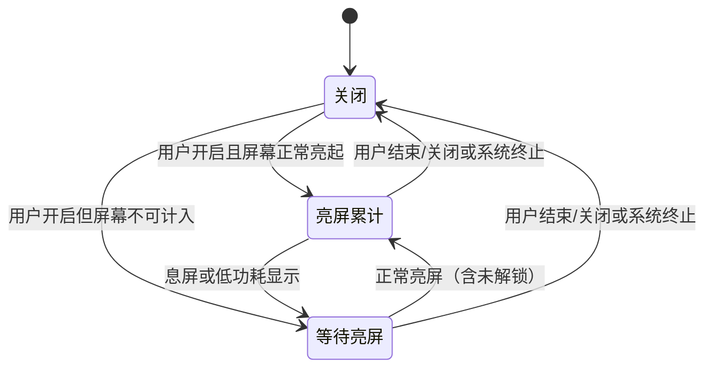

# 随亮屏计时

设置 → 随亮屏计时。默认关闭，用户开启后用同一条正计时会话累计手机正常亮屏的时长：息屏暂停，下次亮屏继续。锁屏点亮也计入，无需解锁；AOD/息屏显示不计入。切到视频App或桌面仍按屏幕状态运行，不判断哪个App在前台。

开关表示本轮会话状态。关闭、首页/浮窗/通知/组件结束或划掉主FF任务后，本轮停止，后续亮屏不重新开始；再次使用需明确开启。系统直接杀进程时无法结算精确终止时刻，下次打开仅恢复最后保存记录并标约计，不补停机时间，也不自动开启。返回前台、设置旋转重建不会重开会话。

有其他计时（包括暂停、超时和C4）不能启用本模式；已有亮屏会话也不会被普通开始、预设或快捷入口替换。它不启用C4、不改全局开关、不绑定目标App、不扣每日额度。只有屏幕控制暂停/继续，手动控制入口统一转为查看/结束，服务拒绝旧请求；普通会话暂停保持。

## 已确认的重要取舍

用户明确要求屏幕驱动和息屏不累计，并确认了[设计](superpowers/specs/2026-11-04-screen-on-timer-design.md)：设置内独立入口、默认关闭/正计时、锁屏计入、同会话互斥、结束后重新开启、无跨进程自动恢复、活动区间与兼容导出。没有新增首页模式、预设字段或后台启动路径。

## 计时、记录与统计

运行条件为`isInteractive() && 默认Display.STATE_ON`，其余OFF/DOZE/DOZE_SUSPEND/ON_SUSPEND/未知或缺失显示不累计。屏幕广播和DisplayListener只重新核对状态，相同状态幂等；不轮询屏幕。时间用elapsedRealtime，息屏停止原tick，不加唤醒锁。厂商上报或事件分发有延迟，不承诺物理点亮瞬间精度。系统控制锁屏上的浮窗可见性，本功能不绕过安全锁屏。

`ScreenOnTracker`保存单调时钟上的活动区间；`TimerRecord.screenTime`可选附加到原原子文件，包含起止跨度与区间，累计等于区间之和。UI、历史图表和CSV使用同一记录；图表按实际区间跨小时/日分摊，不把息屏空档压缩成连续时间。“全部”包含新记录，沿原无App筛选查看，单独标为亮屏计时。

旧记录无新字段时按原经过时间口径显示，不重算；普通暂停历史仍包含原会话经过时间。CSV原十列顺序和含义保留，追加「计时口径」「会话跨度秒数」「亮屏活动区间毫秒偏移」，活动区间是相对开始时间的JSON毫秒偏移。新模式的结束UTC使用跨度，不能用有效累计推导。损坏区间显示读错/统计不完整，不降级成连续跨度。

## 系统与权限边界

用户在可见设置页启动既有FloatingService/specialUse前台服务，屏幕事件只暂停/恢复已经存在的会话。保留原悬浮/通知权限流程，不新增权限、服务、监测、无障碍、开机自启、电池豁免或保活。缺悬浮权限时不开始，授权返回后再次点击开启；系统/厂商仍可结束进程。

系统依据：[Display.getState](https://developer.android.com/reference/android/view/Display#getState())、[PowerManager与屏幕广播区别](https://developer.android.com/reference/android/os/PowerManager#isInteractive())、[前台服务启动限制](https://developer.android.com/develop/background-work/services/fgs/restrictions-bg-start)。

## 验证入口

统一`check.ps1`；单测`ScreenOnTimerTest/ScreenOnHistoryTest/ScreenOnControlsTest`；设备`test-device.ps1 -Suite screen_on -Serial emulator-5556 -AllowTestDataChanges`。设备suite仅专用模拟器，备份还原应用数据、屏幕超时、无密码滑动锁屏、主题、字号和方向；不操作手机。纯模型/脚本、AOSP实际交互、Redmi真机分别记录。

本轮证据、截图和未验范围见[成果说明](validation/20261104-screen-on-timer.md)，用例维护见[统一测试库](testing/README.md)。
