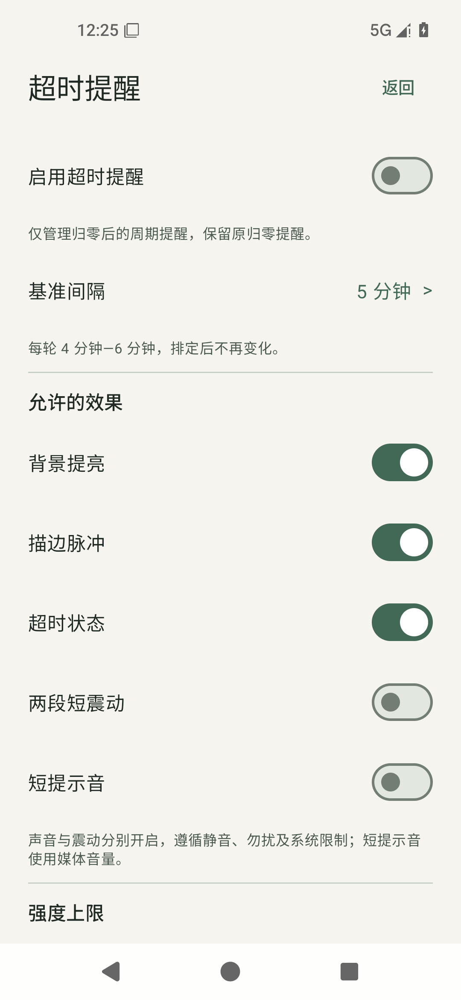
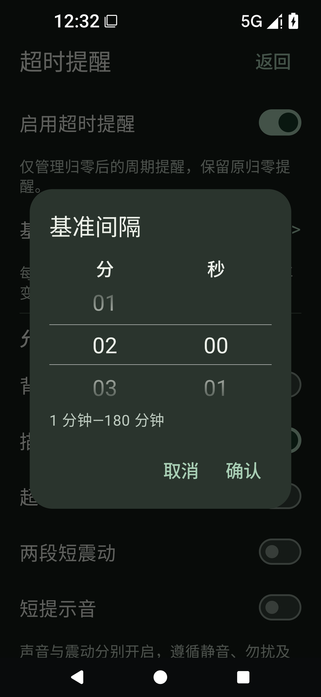
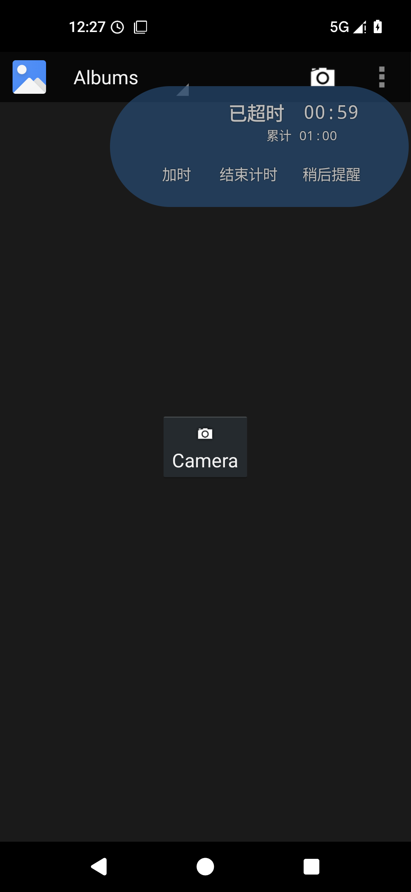
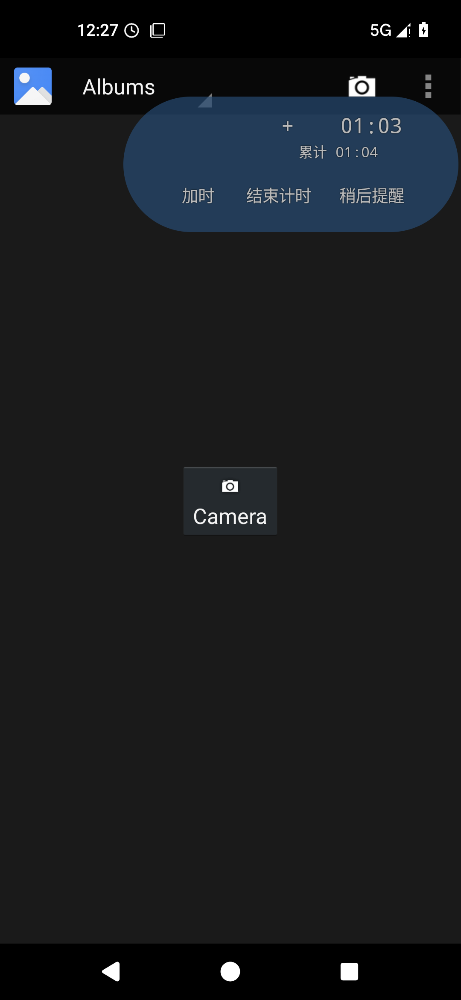

# 超时提醒：本轮成果与验证

2026-11-04；开发分支 `codex/overtime-reminders`；版本保持0.3.0 / code4。未合并main，未发版。本页记录本轮结果，历史模拟器或手机反馈不算本包真机通过。

## 使用变化

设置新增「超时提醒」。默认关闭，开启后默认只允许视觉，短音和两短震分别主动开启。原有归零提醒保持；新功能仅安排归零后的周期提醒，不改变计划、累计、历史或每日App额度。

基准默认5分钟，每轮只抽一次4—6分钟；页面显示实际范围。主动选择「稍后提醒」的一次间隔准确排定（系统休眠仍可能延迟），随后恢复浮动。普通模式不强制展开；「主动选择下一次」模式在普通展开浮窗中增加滚轮入口，首页也可操作。C4只在首页选择，完整装置不改布局。

首轮只允许一种轻量视觉；持续超时达到基准3倍后可使用已允许的声震；主动延后3次后控制区显示计划、实际与次数。近期效果降低权重而非禁止重复，强度不超过上限，不因未点击判断用户未察觉。提亮、描边结束恢复原外观，不降低透明度。

这些默认值、阈值、C4入口和独立强度属于**用户已确认的补充设计**，不是未确认建议；原始明确需求与补充内容见[设计](../superpowers/specs/2026-11-04-overtime-reminders-design.md)。不宣称已证明能减少习惯性忽略。

## 页面与运行证据

| 设置 | 深色、大字体选时 |
| --- | --- |
|  |  |

[交互方式与强度](20261104-overtime-reminders/overtime-settings-choice.png)、[深色设置](20261104-overtime-reminders/overtime-settings-dark.png)。这些截图仅证明所示画面；实际点击、排期和滚轮见设备结果。

| 周期状态显示 | 状态结束后 |
| --- | --- |
|  |  |

[12秒连续录屏](20261104-overtime-reminders/overtime-first-visual.mp4)无声音轨，仅用于时间/控件位置观察；[实际坐标诊断](20261104-overtime-reminders/status-layout-diagnostic.json)是不同于静态截图的证据。不能据此关闭既有Redmi整窗闪动问题。

[完整C4提醒前](20261104-overtime-reminders/c4-full-before-periodic.png)、[第一轮时完整装置](20261104-overtime-reminders/c4-full-skips-visual-during.png)、[后续折叠C4描边](20261104-overtime-reminders/c4-compact-next-round-during.png)。C4归零前不排期，原声忙时跳过短音，不补播；完整装置不应用周期视觉、不被强制切形。

## 实际完成的检查

| 层次 | 本轮证据 | 可确认的范围 |
| --- | --- | --- |
| Debug Full | `.tools/checks/check-full-debug-20261104-202223-802.json` | 构建、239个JVM测试通过；Lint 0错误/警告/提示 |
| Release Full | `.tools/checks/check-full-release-20261104-202812-196.json` | 构建、231个JVM测试通过；Lint 0；未签名，包内无本地录音 |
| 开发脚本 | `.tools/checks/overtime-script-tests-delivery.log` | 41个脚本测试通过；不等于41个设备场景 |
| 周期交互 | `.tools/device-checks/20261104-202534/results.json` | 真正等待周期、设置持久化、跨Gallery、滚轮不拖窗、取消、三次确认、旧段失效、C4两形态 |
| 既有窗口回归 | `.tools/device-checks/20261104-203357/results.json` | 普通累计主显、完整C4、专属阶段前展开的连续坐标；原时间连击、边缘、旋转、实验时钟小时进位 |
| 既有加时回归 | `.tools/device-checks/20261104-203716/results.json` | 实际1分钟归零、内嵌加时、同会话/窗口、再次归零、结束 |
| 生命周期 | `.tools/device-checks/20261104-204110/results.json` | 主开关停/重新排一次、强停重开不续排、撤权清理、正计时无C4/周期事件 |

四个设备批次均为同一最终Debug APK，独立测试数据备份/恢复成功。仅专用AOSP模拟器 `emulator-5556`，Android16/API36、Launcher3；未连接或测试手机。为保护原AVD已有桌面入口，使用新的独立data/cache/sdcard镜像，未删除原快捷方式。

首次自动间隔实测58840ms，在48—72秒范围内；首轮实际STATUS且LIGHT。三次明确延后后，运行日志选中两短震和短音，级别NOTICEABLE；计划仍1000ms，沿用同一会话，不是加时。C4完整装置到期该轮视觉被过滤为空，随后折叠态实际出现OUTLINE。日志中的播放器start、短音请求和振动请求**不代表**真机听感、尾音连续或震感已通过。

新增19个策略测试、5个请求/兼容性测试；整个Debug总数239包含既有用例，不能当成本功能独立覆盖率。完整结构化摘要见[JSON](20261104-overtime-reminders.json)，测试维护源为[统一测试库](../testing/README.md)。新增19条定义；执行按已有粒度追加，不把套件通过拆成未证明的细项。

## 运行中发现并修复的问题

新STATUS文字最初与数字放在同一文本行，中文字体回退使该行高度从128px变141px，按钮随之下移13px。短时间窗口采样一度漏过；实际内容坐标抓到变化，诊断先失败，再修改稳定前缀槽与独立等宽数字槽。

最终运行中时间区域始终为 `(306,28,713,169)`，控件始终为 `(101,169,697,301)`，覆盖STATUS出现/消失及真实分钟进位。没有停止刷新、裁剪或缩字。失败证据201121仍保留，当前202534作为明确同范围复测关联，见 `FF-ISSUE-OT-STATUS-LINEHEIGHT`。原有Redmi/HyperOS“整个浮窗闪下回弹”仍待同包真机验证，不把这次字体问题当作其已证实根因。

测试脚本另修复Gallery冷启动等待和65秒截止日志的1ms采样差；保留原失败记录，没有把测试容差写入实际调度逻辑。

## 源码、APK与音频边界

- 本地交付：`E:/Countdown/dist/FloatingFocus-0.3.0-overtime-debug.apk`；SHA256：`f21c7ccf7950aa9022556a396a7bafb9faf3f22aa5c89a0b525e30bf1420536b`。
- Debug签名已用apksigner核验，证书SHA256 `2119d9676b8cbf5a1efee1f01b74d0846cd5573d4f18f6faf64a73146158d11a`，沿用本机测试签名；无需卸载清数据。不要用同为0.3.0判断是否本包。
- Debug含三段本机C4录音，仅本机使用，不上传GitHub或Release。Release检查包未签名、无这些录音；其C4录音听感不适用，视觉和口令仍适用。新周期短音由系统生成，不依赖录音。
- 原Full检查提交均为 `6a42cf4` + dirty，内容指纹 `70e10e4e8e2e0c7cf014e4ae4647f29c5ab400725bb3e44cfa12c3b1aa014693`，保留原身份，不改写成收尾提交。
- 后续只增加生命周期测试脚本和文档，179项应用/构建输入与Full时逐项相同，见[输入哈希](20261104-overtime-reminders/app-inputs.json)。因此不重复构建APK。生命周期批次整个工作区指纹不同，测试库保守标历史身份；本报告以相同APK+相同应用输入说明其范围，不伪造原指纹。

## 你需要做的最小真机测试

只需本轮Debug、原悬浮/通知权限及日常省电设置，不要新增权限或重测全部历史。以下可以沿同一次普通超时连续完成；C4另开一次。更完整步骤维护在[真机清单](../testing/REAL_DEVICE.md)。

| 用例 | 前置与简短操作 | 明确预期 / 为什么仍需手机 |
| --- | --- | --- |
| FF-PHONE-OT-VISUAL | C4关，周期1分钟，仅STATUS或描边、轻量；短倒计时归零后切视频App，等待第一轮，展开/收起/拖动 | 时间/按钮/外框不闪跳，结束恢复透明度；核对Redmi触摸与整窗行为，AOSP不能代替 |
| FF-PHONE-OT-AUDIO | 沿用已触发首轮的超时会话；明显上限，延后确认3次。仅允许两短震，选1分钟后；再仅短音重复。按日常静音/勿扰/播放状态核对代表场景 | 分别确实感知两短震/短音；关闭某项不影响另项；尊重媒体音量/勿扰/焦点，不强提音量。日志不能证明可听可感 |
| FF-PHONE-OT-C4-BACKGROUND | 本机含录音Debug启动10秒C4；听归零尾音，完整形态等首轮，再收起等后续；锁屏跨一次排期解锁，最后结束或划掉FF | 原C4声不被周期打断/叠加；完整外形不变；最多一轮不补发，结束/划除无残留。HyperOS休眠、真实声衔接尚未执行 |

报用例ID、实际入口/操作、发生时剩余或超时秒数、约时间及现象；必要时附短录屏。声音问题补媒体音量、静音/勿扰、耳机/扬声器和播放中的App。能连接ADB时由AI取可用日志，不需要你整理Logcat。已有同SHA/同机/同系统通过项不无理由重测。

## 尚未覆盖的自动化及验证边界

未执行物理手机、实际试听和触感验证。禁用动画、120ms短音/240ms振动过程中即时关开关、STATUS与三种Debug布局/小时/全部形状的完整组合仍是自动化缺口；不全部转交用户。既有小时进位回归在周期关闭条件完成，不冒充所有新STATUS组合通过。新设定的减少忽略效果需要后续真实使用反馈，本轮未做行为效果实验。

## 修改入口

配置/纯策略：`OvertimeReminders.kt`、`OvertimeReminderSettingsStore.kt`；服务/声震：`FloatingService.kt`、`OvertimeReminderFeedback.kt`、`ReminderVibration.kt`；界面：`OvertimeReminderScreen.kt`、`OvertimeVisualFeedback.kt`、`OvertimeTimeHeader.kt`、两源码集`OvertimeHeader.kt`、`FocusOverlay.kt`、`MainActivity.kt`、`SettingsActivity.kt`。C4只新增只读音频忙状态，不调整音轨/口令/时间轴。测试在`OvertimeReminderTest.kt`、`OvertimeReminderRequestTest.kt`及`device_overtime_reminders.py`；无新增权限、依赖、并行服务或监测。
