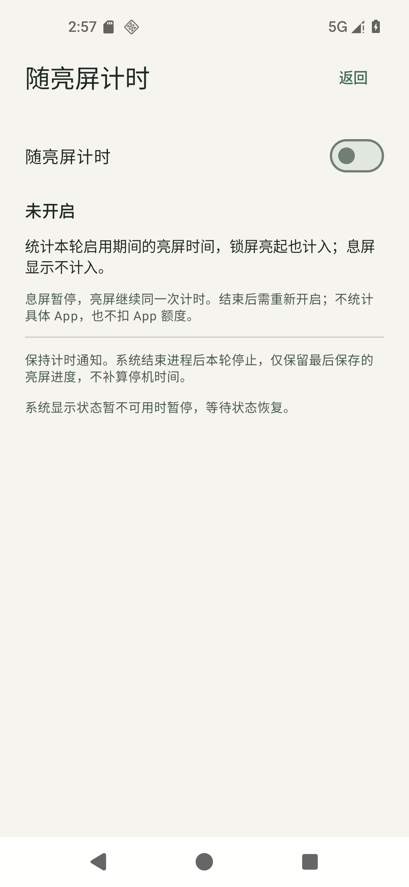
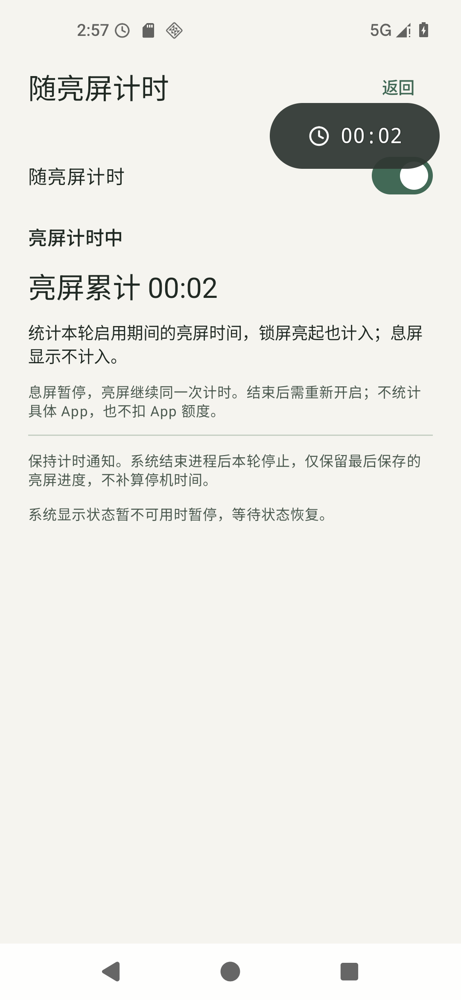

# 随亮屏计时：成果与验证

2026-11-04；版本保持0.3.0/code4，开发分支`codex/screen-on-timer`。不合并main、不发版。

## 用户能做什么

设置新增「随亮屏计时」。开启一次后，亮屏自动正计时、息屏暂停、再次亮屏继续同一条记录，锁屏亮起也算。默认关闭；主动结束或进程结束后不再因亮屏重启，需要明确重新开启。

本轮按已确认设计采用：设置内独立入口、由屏幕唯一控制暂停、保留主动结束、无跨进程自动恢复；不替换其他会话，不启用C4、不改全局C4、不扣App额度。它统计FF启用期间的亮屏时间，不是某个App的真实使用时长。无新权限、依赖、服务或保活。

## 实际画面

| 关闭 | 正在累计 |
| --- | --- |
|  |  |

[锁屏尚未解锁](20261104-screen-on-timer/screen-on-locked-running.png)、[深色1.5倍字体](20261104-screen-on-timer/screen-on-dark-large.png)、[横屏重建](20261104-screen-on-timer/screen-on-landscape.png)、[历史明细](20261104-screen-on-timer/screen-on-history.png)。截图只证明所示画面；计时/持久化由下面实际断言证明。

## 为什么新增记录字段

原普通记录有意统计会话起止跨度，包含暂停；本轮保留旧数据和普通行为。新记录追加实际亮屏区间与跨度：有效累计与起止跨度分别保存，图表只分配活动区间，CSV保留原十列并追加口径、跨度和区间。不能只暂停数字却仍在历史计入息屏，也不能把亮屏累计压成一段连续时间。

## 已执行的验证

| 层次 | 结果与原证据 |
| --- | --- |
| Debug Full | 260项JVM通过，Lint0错误/警告；`.tools/checks/check-full-debug-20261104-224809-460.json` |
| Release Full | 252项JVM通过，Lint0错误/警告；`.tools/checks/check-full-release-20261104-224942-800.json` |
| 亮屏设备专项 | 同一Debug APK在API36专用AOSP模拟器完成，`.tools/device-checks/20261104-225644/results.json`，应用数据和设备配置恢复成功 |
| 原历史回归 | `.tools/device-checks/20261104-230534/results.json`整套通过：旧记录、图表/筛选、真实CSV、读取失败、活跃记录重试及空态 |
| 开发脚本 | `.tools/checks/screen-on-script-tests-final.log`，43项脚本检查通过；之后仅调真机最小集排序，15项整理器测试复核通过，不将两次计数相加 |

专项实际核对：无权限不开始；重复亮灭同ID；息屏落盘冻结；Keyguard实际showing=true时尚未解锁累计增长；Gallery前台继续；设置返回、深色/1.5字体/旋转保持同会话；手动结束后亮屏不重启；普通及真实C4阶段冲突；存储重读与真实系统文件选择器CSV导出；强停恢复只保留实际落盘检查点；撤权清理；重叠区间JSON显示读错，未当作连续时间。

首条真实结束记录：亮屏有效 **37.433秒**，会话跨度 **42.592秒**，差额是未计入的息屏空档；活动区间为`[[59, 3367], [8467, 42592]]`。这不是用固定sleep时长推测，而是读取应用实际记录并核对区间总和。完整数值与身份见[JSON](20261104-screen-on-timer.json)。

原失败批次保留：224942为测试AVD原来禁用了锁屏；225159为脚本错误假定回到首页而实际恢复设置页；225353为1.5字体下历史记录在屏幕下方，脚本未滚动查找。均还原数据，不作为应用通过；修正测试后225644整套通过。没有用取消锁屏断言、缩字号或清空返回栈来让测试通过。

原历史套件230131在ADB输入返回1处失败，当时工具没有保留stderr，未核实根因；没有Android崩溃日志。补充命令错误输出后230534整套通过，不把它写成已经定位或修复的应用缺陷。

独立代码审查发现旧普通通知无身份STOP可能结束新的亮屏会话，已增加服务端身份校验，并给新模式首页/通知/开关绑定会话与段；纯模型失败测试后纳入260项绿色检查。普通STOP保留兼容。旧PendingIntent跨会话的真实系统投递未执行，不把纯模型证明说成设备实测。

## 构建身份

- 默认产物：`E:/Countdown/app/build/outputs/apk/debug/app-debug.apk`；交付副本：`E:/Countdown/dist/FloatingFocus-0.3.0-screen-on-debug.apk`。
- Debug SHA256：`203256b93b8fc24045f359fe90d084ed760dba9d207b489398b5167c9c706f59`。沿用原本机测试签名，覆盖安装不卸载清数据。
- Full检查保留其原commit/dirty/指纹，不改写为最终提交。之后仅设备脚本/文档完善，185项应用/构建输入逐项相同，见[输入哈希](20261104-screen-on-timer/app-inputs.json)。测试库保守保留不同工作区指纹的身份，不伪造当前通过。
- Debug沿用三段本机C4音频条件，仅供本机，音频和APK不上传。Release无录音、未签名；本功能不依赖任何音频。

## 仍需你实机确认的最小集

| 用例 | 简短操作 | 预期与现有证据不足 |
| --- | --- | --- |
| FF-PHONE-SCREEN-ON-001 | 开启后息屏约20秒，亮起但不解锁约10秒后查看；若日常已开AOD，再让其息屏显示约30秒 | 只增加正常亮屏那段，不把息屏/AOD整段加进去。AOSP没有Redmi真实AOD/接近传感器表现 |
| FF-PHONE-SCREEN-ON-002 | 接着在其他App使用2—3分钟，含两次息屏；再从最近任务划掉FF，亮屏并重开核对 | 同记录仅累计亮屏；划掉后不再自动开始。HyperOS任务/省电清理与AOSP不同；无回调强杀仅最后检查点约计 |

使用本轮同SHA Debug、已有悬浮权限和日常通知/省电配置，不要求新增权限或修改手机省电习惯。上两项可连续完成；不需要重测与本功能无关的桌面图标、音频或震动。

反馈用例ID、亮灭屏顺序、锁屏/AOD状态、前后累计及约发生时间，必要时短录屏；沿用已知REDMI K80/Android16，系统有更新才补版本。可连接ADB时由AI读取可用日志/记录，不要求你筛Logcat。

本轮未执行真机。AOD真实硬件、多屏/折叠设备及显示事件极端延迟仍有边界；统计使用系统状态而非光学测量，不承诺物理点亮瞬间精度。具体状态和官方依据见[功能说明](../SCREEN_ON_TIMER.md)。

## 代码入口

`ScreenOnTimer.kt`为纯活动区间与计入条件；`ScreenStateObserver.kt`为公开显示事件；`FloatingService.kt`复用唯一会话/时钟/原清理；`ScreenOnTimerScreen.kt/SettingsActivity.kt`为设置入口；`SessionControls/TimerWidgetModel/TimerTileModel/MainActivity`统一控制；`TimerRecord/TimerRecordStore/HistoryStatistics/HistoryScreen`保持口径与持久化；无新权限及并行服务。
