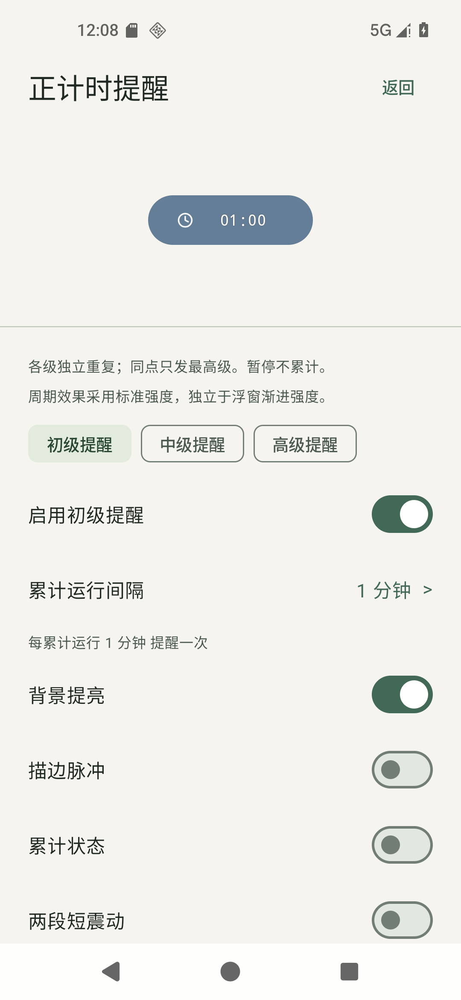
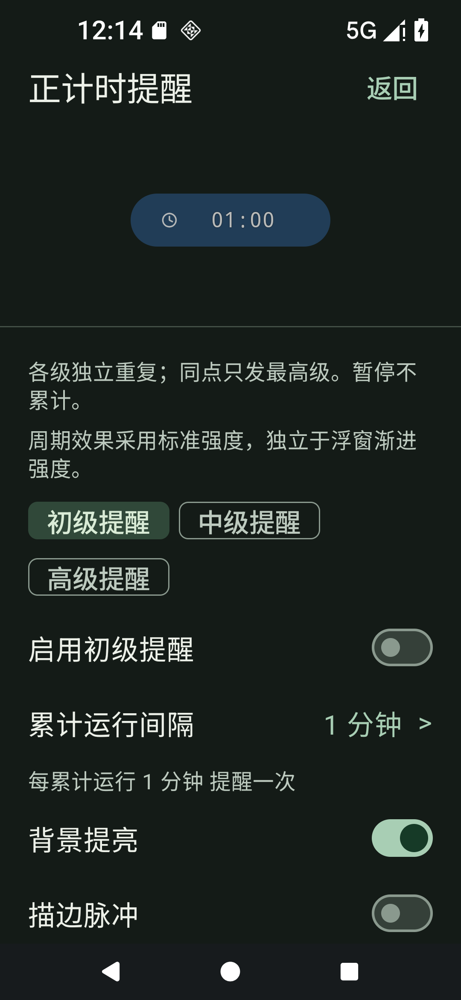
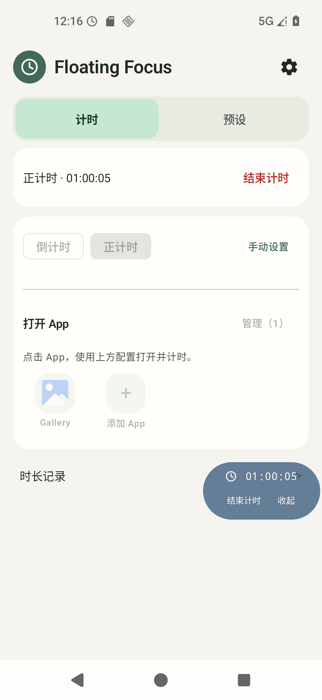
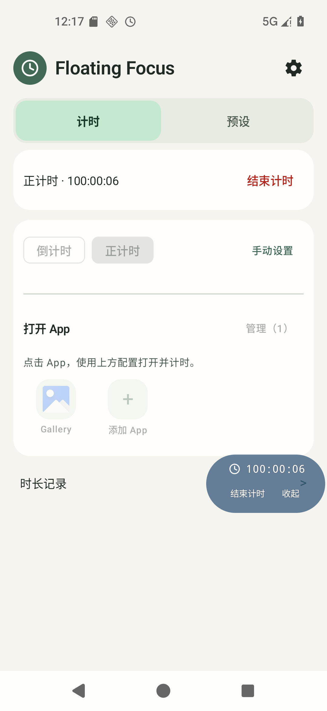

# 正计时周期提醒与长时长显示（2026-11-05）

## 使用变化

「设置 → 正计时提醒」提供初级、中级、高级三条独立周期，首次都关闭，默认5/15/30分钟；分别选择间隔和背景提亮、描边、累计状态、短震动、短音。周期按实际运行累计，暂停不算。同点仅发最高级，不能把三级理解为倒计时百分比节点。

规则按用户确认随预设保存：普通/快捷App/默认组件磁贴用当前规则，预设入口按ID读自己的规则，会话开始后固定。编辑预设取消不写回；异常续计沿用原规则与累计，不补停机或过去节点。声音和震动另有全局总许可，首次关闭、立即生效且不进预设，不能由预设重新打开。倒计时/C4不运行本周期引擎，未增加权限、依赖或后台保活。

正计时不足1小时仍为MM:SS，达到1小时为HH:MM:SS，276:20对应04:36:20，超过24/99小时继续累加。浮窗、首页/续计、通知、原生桌面及磁贴共用对应读数；统计、CSV和旧记录累计口径不变。

## 界面证据

以下为本包原始模拟器截图，不是设计稿；使用测试数据。截图只说明所见布局，持续稳定性另见10秒录屏及坐标断言。

| 正式设置 | 深色与1.5倍字体 |
|---|---|
|  |  |

| 展开后01小时 | 100小时 |
|---|---|
|  |  |

[真实桌面01小时](20261105-stopwatch-reminders/widget-one-hour.png) · [真实桌面1000小时](20261105-stopwatch-reminders/widget-thousand-hours.png) · [2倍字体长时长](20261105-stopwatch-reminders/large-font.png)。长时长以可靠测试检查点续计进入，计时随后真实运行；没有伪装成等待1000小时的实测。

## 实现与修正原因

- 原formatElapsed一直按总分钟输出。统一小时格式，同时单独处理系统Chronometer原生H:MM:SS的补零，不能拿字符串单测证明原生宿主已经正确。
- 旧浮窗所有标题共用240dp宽度限制，极长小时数在大字体下实际出现Text overflow。正计时标题改为先测完整文字、再统一通过已有安全区几何处理，保留等宽预留及时间锚点；普通倒计时/C4和控件原测量不变。未裁剪、停止更新或自动缩字。
- 独立审查发现暂停回调先于积压提醒时会留下已过节点：现于暂停采样静默推进，继续不补发；又发现坏正计时设置误阻塞保存倒计时预设：共用解析策略现在对倒计时不读取该存储。两项均先运行失败用例，再修正并完整检查通过。

| 文件组 | 职责 |
|---|---|
| StopwatchReminders / SettingsStore | 纯整数倍周期、严格Codec、当前规则与即时总许可 |
| StopwatchReminderScreen / SettingsActivity / OverlayPreview | 共用编辑、预设独立草稿、真实渲染只读预览和明确试听 |
| TimerPreset / Store / TimerPresetsCard / PresetLauncher / AppTimerLauncher | 保存当前及共用入口传递，不改变ID、App绑定和位置 |
| FloatingService / StopwatchRecovery / OvertimeReminderFeedback | 同一服务调度、恢复、暂停和资源清理，复用现有效果 |
| Countdown / StopwatchTimeHeader / FocusOverlay / MainActivity / TimerWidgets / Model | 统一小时读数、稳定测量及原生格式区间 |
| 新增JVM测试与device_stopwatch_reminders.py | 计算、快照、权限过滤及真实设备集成证据 |

## 本次实际验证

- Debug完整检查292项JVM通过，Release284项通过，两种构建Lint均0错误/警告。原摘要分别为`.tools/checks/check-full-debug-20261105-200627-508.json`、`.tools/checks/check-full-release-20261105-200747-260.json`。8项差额来自既有Debug专用测试。
- 开发脚本43项回归通过，完整日志`.tools/checks/stopwatch-script-tests-final-20261105.log`；测试库校验通过，新增15个有稳定ID的模型/集成/真机场景，保留所有原批次。
- 三周期真实服务在60001/120000/180003ms分别发出PRIMARY/MIDDLE/HIGH，容差断言<2.5秒；120/180秒到达的其他规则不叠加。总许可关闭时HIGH仅保留视觉。通过实际组件暂停/继续、随亮屏息屏冻结、源规则恢复和旧节点不补发检查。
- 设置滚轮保存、预设编辑取消/保存、真实Gallery预设启动及与当前规则不同、活跃会话固定、预览不创建服务/记录已断言。显式试听只核实请求，不宣称声音或震动感受。
- 三形状/折叠与展开中跨59:59/1h、99h/100h采样10秒原生窗口及内容坐标，单场景frame/时间区坐标均固定；实际旋转后可显示。真实通知和Launcher组件分别核对01/100/1000小时。字体2.0、100000小时压力夹具Text overflow=false，时间完整可见。
- 既有widgets完整回归通过：默认/预设启动、读最新、权限、互斥、暂停、超时/C4限制、冷启动、深浅/大字体及真实缩放。既有overlay_stability通过普通累计主显、完整C4、专属阶段前展开、边缘/时间锚点与进位场景，未关闭历史Redmi/HyperOS整窗闪动问题。

| 设备套件 | 本次原证据 |
|---|---|
| stopwatch_reminders | `.tools/device-checks/20261105-200747/results.json` |
| stopwatch_hours | `.tools/device-checks/20261105-201521/results.json` |
| widgets | `.tools/device-checks/20261105-202002/results.json` |
| overlay_stability | `.tools/device-checks/20261105-202356/results.json` |

均为同SHA Debug、专用emulator-5556；每次校验安装包并还原应用数据。另于本轮采集环境为AOSP Android16/API36、Launcher3，采集时间与系统build见[结构化记录](20261105-stopwatch-reminders.json)。旧runner批次未带的环境字段不回填改写。

保留失败证据：174442诊断复现原文字截断；195914是预览按钮未滚动到，200104/200503是固定预览导致测试大幅滑动跳过开关；200425单测实际292项/2失败复现审查问题。各原始结果保留，后来通过不覆盖或伪装当时通过。

## 已采用的设计取舍

1. 间隔1—180分钟、精度1秒，沿用现有滚轮上下限，不新增范围设置；代价是本轮不支持小于1分钟或超过3小时的周期。
2. 各级是独立规则，同点最高级；复用标准强度，不随等级自动提高音量或面积。另选组合叠加会增加声震重叠与解释成本，本轮未采用。
3. 原生桌面用格式区间更新，通知以原有服务采样显示HH；没有新轮询/时钟。代价是系统可能限速通知刷新，厂商仍需真机观察。
4. 极长读数先自然测量，再统一安全区适配；不沿用旧240dp裁剪。极端窄屏只能服从实际可用区域，不能承诺无限位数保持同一物理字号。

## APK及身份

版本保持0.3.0/code4；没有合并、递增、标签或Release。默认构建产物仍在`app/build/outputs/apk/debug/app-debug.apk`；交付副本为`dist/FloatingFocus-0.3.0-stopwatch-reminders-debug.apk`。

- Debug SHA256：`904cde2d3ab613ad21d5bcce19139b72e0a7cea0bdafd1590a65bd39cb68ba16`。
- Release SHA256：`1356c554e35e8ae98d120801331130505a05ddf54165a70b0ff0bd7f8053cf67`；未签名验证产物，不作为本次安装包。
- Debug沿用证书SHA256 `2119d9676b8cbf5a1efee1f01b74d0846cd5573d4f18f6faf64a73146158d11a`，含3段本机C4录音，仅本机交付，不上传APK/素材。Release无这些录音；本次正计时短音为既有系统生成提示，不依赖C4素材。
- 原构建提交411c246+dirty及指纹不改写成后来提交；205项应用输入哈希与媒体来源另存于结构化报告。后续文档/脚本整理不是新APK，不据此虚构新构建通过。151项用户素材/视频文件保持原哈希，用户指南原空行修改保留。

## 仍需你做的真机最小集

使用上述同SHA Debug；保留已有悬浮权限及日常通知/省电设置，不新增授权。已知手机REDMI K80/Android16；本包尚无真机结果，不把旧版振动成功或模拟器通过当成已验收。

1. **周期与声震，约5分钟（FF-PHONE-SW-REMINDERS-001）**：三级设1/2/3分钟，初级提亮、中级描边、高级提亮+短音+震动；两总许可关闭，开始正计时并打开视频App等待3分钟。应对应三级视觉、无声无震；结束后只开高级1分钟并开启两总许可，再开始一轮，实际确认短音、两段震动和媒体声音能恢复。可以将第二轮设为随亮屏，在约45秒息屏10秒再亮屏，应再累计约15秒才提醒。目的：确认厂商后台调度、实际声震和焦点；AOSP/API请求不够。
2. **系统限制，合并上一步**：明确点击试听时分别核对媒体音量0、静音、勿扰及其允许例外，再恢复日常设置。FF不得强行调高音量；声音/震动各许可关闭时相应效果停止，开启不能重播旧周期。实际勿扰执行由系统例外规则决定。
3. **建议补看厂商宿主（FF-PHONE-SW-HOST-001）**：日常已有1小时以上会话时看通知/桌面/浮窗是否01:xx:xx，旋转与展开后是否稳定；无需专门等一小时。AOSP已覆盖纯格式、真实原生时钟、100/1000小时和大字体，以上自动化项目无需你重复。

若异常，回复用例ID、当前SHA或本交付包名、操作与约发生秒数、系统声音/勿扰状态，附有问题的一段录屏。授权连接ADB后由AI读取日志，不要求手工筛日志。手机声震/媒体焦点、厂商限速与原窗口闪动均未在本轮真机验证；桌面预设快捷方式/磁贴的新规则由共用启动路径静态核对，本轮未为它们单独逐入口真机验收。

测试库维护源为cases.json及只追加runs.jsonl；截图/汇总不替代逐项结果，使用同一目标SHA筛选，旧记录保持原身份。
