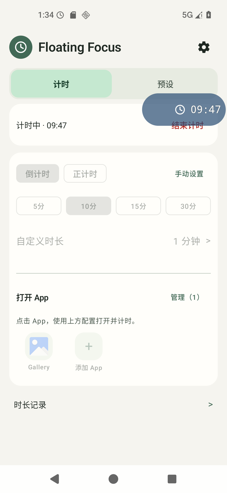
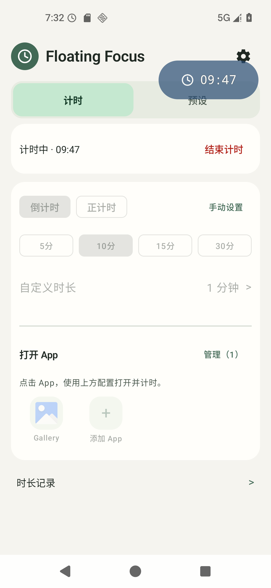

# 正计时生命周期、续计与方向位置：成果与验证

2026-11-05；版本保持 **0.3.0 / code 4**。开发分支 `codex/stopwatch-lifecycle`；不合并 main、不发版。

## 本次行为变化

1. **划掉最近任务，计时与浮窗继续。**倒计时及两种正计时均沿用原前台服务；主动结束仍正常结算。厂商一键清理可能直接杀进程，系统强停也始终有效，不承诺所有机型常驻，不自动拉活。
2. **正计时异常后可明确继续。**主页显示最近的可恢复累计和最后保存时间；历史中的“全部中断正计时”可找到较早任务。点继续才恢复，不打开原 App，不补停机。新段关联原记录，只把新运行时间加入统计与额度；正常结束、已接续父段和没有可靠检查点的旧普通记录不可续计。
3. **设置改为“正计时方式”。**“息屏仍计时”可手动暂停；“随亮屏计时”仅随屏幕暂停/继续，锁屏点亮计入，AOD/息屏不计。设置本身不启动计时，仅下次明确开始生效。普通/快捷 App/组件/磁贴用当前设置，预设保存独立方式，旧预设默认连续。正计时不启用 C4。
4. **数字与方向位置修复。**折叠数字相对背景居中；横竖屏各存一份位置，普通计时与各预设分开。展开、旋转、防越界不覆盖拖动记录。旧单位置只由首次使用方向承接；另一方向安全默认，未拖动方向的本会话初始锚点也保持稳定。

以上按用户已确认设计实施。主要取舍：真正进程死亡后采用明确续计，避免不可核实的停机被算入；方式只影响下一会话，避免中途改变口径；续计分段关联，避免父段重复进入统计。未新增权限、服务、依赖、唤醒锁、后台自动重启或厂商绕过。

## 旋转问题的实际原因与前后对比

旧布局把展开标题的横向补偿继续用于收起状态；旋转后外框已防越界，收起标题仍保留补偿，导致时间偏离背景中心。另外，未保存位置的方向在切回时按展开尺寸重新建立默认中心，导致随后收起整窗偏移。分别修复折叠内容居中和本会话默认锚点缓存；不靠裁剪、缩字或事后反复补移。

同条件：1080×2340、基础大小1.0、蓝色、不透明度0.7、普通倒计时。横屏展开拖动→回竖屏收起。下图是原始截图，未编辑图像；时间读数自然不同。

| 修改前 | 修改后 |
| --- | --- |
|  |  |

旧截图本地标题中心270px，背景中心205px；新截图标题中心205px。最终包未拖动竖屏时，切换前后 frame 均为 `(626, 235, 1036, 401)`。坐标及完整哈希见[结构化报告](20261105-timer-lifecycle.json)。这些坐标证明本场景布局，不代替持续帧稳定性或真机触摸验证。

[计时方式](20261105-timer-lifecycle/behavior-setting.png) · [明确续计](20261105-timer-lifecycle/recovery-offer.png) · [较早中断任务](20261105-timer-lifecycle/older-recovery-candidates.png) · [深色大字体](20261105-timer-lifecycle/screen-dark-large.png)。亮屏设置与深色大字体图来自05f中间包，其页面和亮屏实现与最终包相同；续计图来自最终包。

## 已执行的检查

| 检查 | 实际结果 |
| --- | --- |
| Debug Full | 278项JVM通过；Lint 0错误/警告。`check-full-debug-20261105-151350-051.json` |
| Release Full | 270项JVM通过；Lint 0错误/警告。`check-full-release-20261105-151628-285.json` |
| 开发脚本 | 43项通过；原日志 `.tools/checks/lifecycle-script-tests-20261105-final.log` |

| 设备套件 | APK身份与复用范围 | 原证据 |
| --- | --- | --- |
| timer_lifecycle | 最终包 | `.tools/device-checks/20261105-153717/results.json` |
| screen_on | 中间05f包，按影响复用 | `.tools/device-checks/20261105-145309/results.json` |
| history | 中间05f包，按影响复用 | `.tools/device-checks/20261105-150506/results.json` |
| overlay_rotation | 最终包 | `.tools/device-checks/20261105-152732/results.json` |
| overlay_stability | 最终包 | `.tools/device-checks/20261105-153202/results.json` |

专用 AOSP Android 16 / API36、Launcher3、`emulator-5556`。各套件校验真实安装APK并还原应用数据。生命周期专项实际移除Launcher最近任务后确认同ID继续；强停后无自动恢复、停机不扣额；双击只建一个后继；保存/取消预设方式、权限缺失、坏记录重试、旧日期候选及真实CSV均有断言。原预设改绑后续计仍属原App且不打开App；删除后不复活预设，拖动只更新续计检查点，不串写普通位置。亮屏专项核对锁屏点亮、息屏冻结、恢复仍按原方式、连续模式息屏累计、深色大字体及主动结束。

194项应用输入对比确认，中间05f包与最终包只差 `OverlayWindow.kt` 的默认锚点缓存；亮屏/历史结果按此影响范围复用，不冒充最终包重跑。最终包重新执行三形状×两尺寸、无拖动默认位置、双方向保存、预设隔离/旧位置迁移，以及普通超时/C4展开的逐秒稳定性与原时间锚点操作。原始构建与设备批次的提交、dirty、指纹和APK身份均保留，不改写为后来的干净提交。测试库按全工作区指纹保守分类，当前设备门禁仍可看到151628准备失败；后续完整通过因仅脚本/资料指纹变化保留原分类，已关联复测并在本报告按应用输入核对影响，不为把汇总刷绿改写原结果。

失败证据保留：102252为API36最近任务字段断言错误；104016为测试上滑未真正移除任务；151256复现无拖动默认位置偏移；151628/151959/152319在方向准备不一致时失败，新增真实屏幕尺寸检查并在FF进入前台后建立方向，后续完整套件通过。不能用这些失败批次或部分子步骤代替整套通过。

## APK与使用条件

- 默认产物：`E:/Countdown/app/build/outputs/apk/debug/app-debug.apk`；交付副本：`E:/Countdown/dist/FloatingFocus-0.3.0-lifecycle-debug.apk`。
- Debug SHA256：`0bb65568353fbed6266e14718b6bfecd6d6f46bc4574df574dd26bf8624a209a`。
- Release SHA256：`be4a716c8e3bdf97ca6a238f1c915c5e20ea3f9c50ac01117f5097575034e3c4`，未签名验证产物，不作为本次手机安装包。
- Debug沿用本机测试签名（证书SHA256 `2119d9676b8cbf5a1efee1f01b74d0846cd5573d4f18f6faf64a73146158d11a`）；包含3段本机C4音频，APK和素材不提交/公开。Release不含这些音频。此次正计时和位置验收不依赖C4声音。

## 真机最小集（本轮尚未执行）

使用上述同SHA Debug，保留手机日常通知、省电配置和已有悬浮权限；无需新增授权，也不要求修改厂商限制。已知REDMI K80/Android16，若系统更新再补实际HyperOS版本。下面可顺序完成，约5分钟。

| 优先级 / 用例 | 操作 | 预期及为何仍需真机 |
| --- | --- | --- |
| P1 · FF-PHONE-SCREEN-ON-001 | 设置随亮屏，回首页明确开始正计时；息屏20秒，再锁屏点亮10秒，解锁核对。日常已开AOD则再观察30秒AOD | 只累计正常亮屏，锁屏点亮也计，息屏/AOD整段不计。Redmi硬件事件与AOSP不同 |
| P1 · FF-PHONE-LIFECYCLE-001 | 接着切其他App，划掉FF，看浮窗/通知；另起一轮执行一键清理 | 普通划除应继续同会话。一键清理若杀进程，则不补停机或自启动；重新进入可明确续计。厂商策略须实测 |
| P0 · FF-PHONE-RECOVERY-001 | 正计时运行约20秒，应用信息强停；等20秒重开。先不点，再点一次继续，运行约10秒结束 | 不自动续；从提示的已保存值继续，只增加后10秒，不加停机20秒，不重复结算。未落盘尾段可能少计；实际强停/后台IO需核对 |
| P1 · FF-PHONE-ROTATION-001 | 普通倒计时关闭C4，保持日常形状；竖屏拖左上，横屏拖右上，展开后回竖屏收起，两轮并连点原时间 | 各方向回各自位置，数字居中，不误触结束。厂商浮窗触摸及安全区需实测；本项不关闭原HyperOS逐秒整窗闪动问题 |

异常反馈：用例ID、操作顺序、发生约时间、前后累计和看到的现象；位置问题附短录屏，AOD/后台问题说明当时锁屏及日常省电状态。可连接ADB后由AI读取可用记录/日志，无需手工筛Logcat。未执行本轮手机测试，也未重测与本次无关的C4听感、震动或桌面图标，不把旧结果算成本次真机通过。

## 主要代码入口

`StopwatchBehavior/Store`与`ScreenOnTimerScreen`管理偏好；`TimerPreset/Store`与`SettingsActivity`管理草稿/快照；`FloatingService`与`TimerTaskPolicy`负责唯一会话和任务划除；`TimerRecordCodec/Store`、`StopwatchRecovery/Controls`负责可靠检查点和关联续计；`HistoryStatistics/HistoryScreen`只统计每段自己的区间；`OverlayPositions/Store`、`OverlayPosition/Window/TouchLayout`负责双向锚点和手势。验收入口与维护见[正计时文档](../SCREEN_ON_TIMER.md)、[统一测试库](../testing/README.md)。
